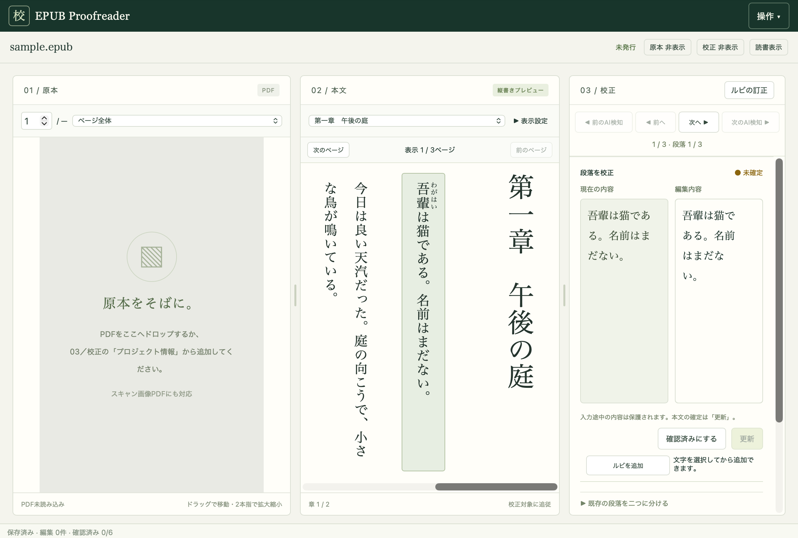
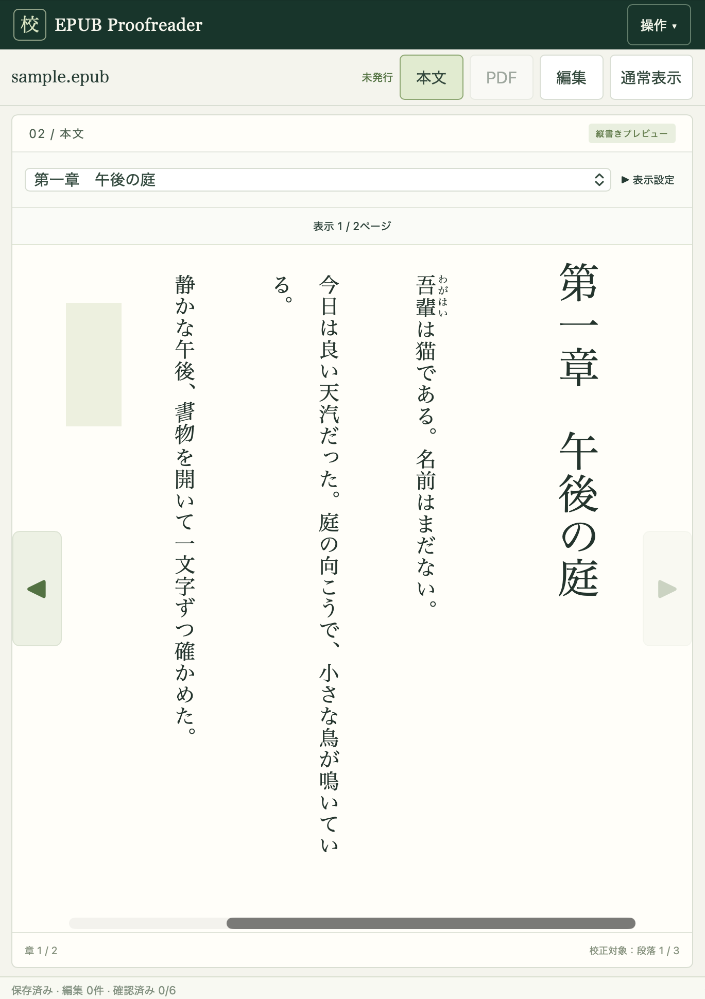

# EPUB Proofreader

## 概要

**EPUB Proofreader** は、日本語のOCRから作成したEPUBを、元のPDFと見比べながら校正するためのWebアプリです。縦書きとルビに対応し、AIが見つけた誤認識の候補を確認しながら修正できます。

通常の校正画面では、原本・本文・編集内容を並べて確認できます（画像はPDF未読み込み時）。



読書表示では本文を大きく表示し、必要なときに編集へ切り替えられます。



## 主な機能

- **EPUBの表示・編集**：縦書き・横書きの本文を表示し、段落や文を選んで校正。文字の修正に加え、選択した文の前後への章・段落の追加、カーソル位置での段落分割、前後の段落との統合、h1〜h6の見出しレベルの選択と階層付き目次の追加、階層を字下げした章選択、空行の追加、文・段落の削除、章の見出しを削除して前の章へ統合する操作にも対応します。
- **原本PDFとの照合**：PDFを横に表示し、文字レイヤーがある場合は校正箇所に合わせてページを自動追従します。手動で対応ページを指定することもできます。
- **ルビの校正**：親文字と読みを専用画面で編集し、ルビの追加・削除や親文字の範囲調整もできます。
- **AIによる誤認識の検出**：OpenAI、Google Gemini、Anthropic Claude、Ollamaに対応。現在の段落・章・書籍全体を検査し、指摘箇所へ移動して確認できます。エラー詳細から返答形式の不正や接続・応答エラー、AI出力全文と停止理由も確認できます。
- **校正の進捗管理**：段落・文ごとの校閲状態を管理し、確定した箇所をAI検査から除外できます。書籍全体のAI検査と確認済みの割合を、プロジェクトごとの100点満点の進捗として表示します。AIの指摘の確認・修正や、検索・置換もできます。
- **プロジェクト保存とEPUB発行**：作業は自動保存。ブラウザーごとに前回の編集位置を記憶します。原本を保持したまま作業を進め、校正後のEPUBを版として発行できます。作業データの書き出し・復元、プロジェクトの削除、不要データの整理にも対応します。
- **iPadでの利用**：タッチ操作向けの読書表示と校正画面を用意しています。

## 特徴

- **原本を守る設計**：AIの提案は自動反映せず、利用者が確定した修正だけを本文に適用します。元のEPUBは保持します。
- **日本語の書籍向け**：縦書き、ルビ、旧字や歴史的仮名遣いなどを考慮し、OCR由来の誤りを見つけやすくします。
- **EPUB構造を維持**：元のXHTMLを編集し、プレビュー画面からEPUBを作り直しません。章を追加してもXHTMLファイルを増やさず、発行時には構造を検証します。
- **同時編集の保護**：別のブラウザーで編集中の箇所をロックし、古い内容による上書きを防ぎます。
- **ローカルで作業を管理**：プロジェクトや校正結果をローカルに保存。Ollamaを使えばローカルAIによる検査も可能です（推奨：Gemma 4 12B）。クラウドAIを利用する場合は、検査対象のテキストが各サービスへ送信されます（PDF画像は送信しません）。

## セットアップ

### Docker（推奨）

Docker Composeが使える環境なら、ソースやPythonの取得なしで起動できます。

```bash
mkdir epub-proofreader
cd epub-proofreader
curl -fL https://raw.githubusercontent.com/fhama74/epub_proofreader/main/compose.ghcr.yaml -o compose.yaml
docker compose pull
docker compose up -d
```

初回に保存先と暗号化キーを自動作成します。起動後は **http://127.0.0.1:8000/** を開いてください。詳しい設定・バックアップ・移行・ソースからのビルドは [Docker運用手順](docs/DOCKER.md) を参照してください。

### Pythonで起動

Python 3.12以上、[uv](https://docs.astral.sh/uv/)、Node.js／pnpmが必要です。GitHubのリポジトリを取得したディレクトリで実行します。

```bash
cd frontend
pnpm install --frozen-lockfile
pnpm build
cd ..

uv sync --locked
uv run uvicorn epub_proofreader.app:app --app-dir backend --host 127.0.0.1 --port 8000 --workers 1 --timeout-graceful-shutdown 5
```

起動後、ブラウザで **http://127.0.0.1:8000/** を開いてください。

クラウドAIのAPIキーを保存する場合は、暗号化キーの設定が必要です。ローカル環境では次のスクリプトを利用できます。

```bash
python3 scripts/configure_local.py
```

AIエンジンの接続先とモデルは、アプリ内の「AI検査・結果一覧」→「エンジン管理」で設定できます。

## ドキュメント

[Docker・運用手順](docs/DOCKER.md)

## ライセンス

自作コードは [MIT License](LICENSE) です。依存ライブラリ等のライセンスは [第三者ライセンス](THIRD_PARTY_NOTICES.md) を参照してください。
